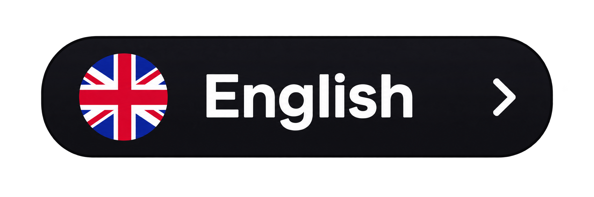
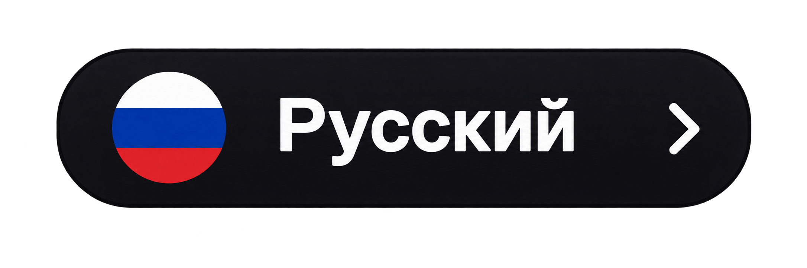

# CosmoTab

  <strong>Explore the Universe with every new tab.</strong>
   
  Turn your browser into a window to the endless cosmos.

  
  &nbsp;&nbsp;
  

  
  

---

  

---

## About

**CosmoTab** transforms every new browser tab into a journey through space.

Enjoy breathtaking views of Earth, distant planets, and stars. Its minimalist interface combines a beautiful cosmic atmosphere with useful everyday tools.

## Features

- **Earth from Space** — A stunning view of our planet surrounded by the endless universe.
- **Cosmic Atmosphere** — Stars, planets, and the beauty of deep space.
- **Clock** — Stylish digital clock displaying the current time.
- **Quick Access** — Instantly open your favorite websites.
- **Google Search** — Search the web directly from your new tab.
- **Weather** — Convenient weather information widget.
- **Media Widget** — A compact panel displaying media information.
- **Customization** — Personalize the interface to your liking.

## Design Philosophy

CosmoTab is designed for those who appreciate minimalism, aesthetics, and comfort.

Every detail of the interface captures the feeling of observing Earth from outer space while keeping essential tools just one click away.

## Your Universe Starts Here

Open a new tab. Leave the ordinary behind. Explore the cosmos.

---

  <strong>CosmoTab — A piece of the Universe in every tab.</strong>
   
  Made with love.

