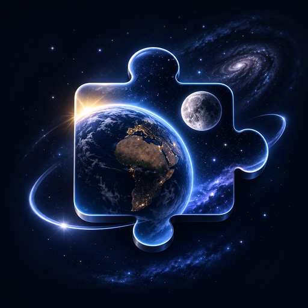
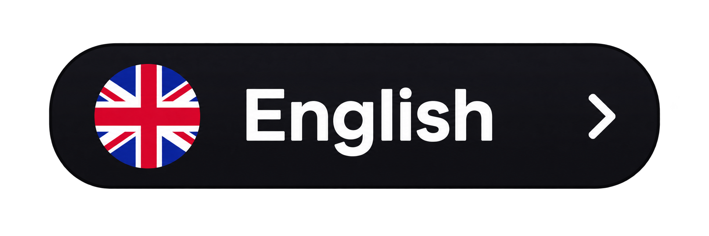
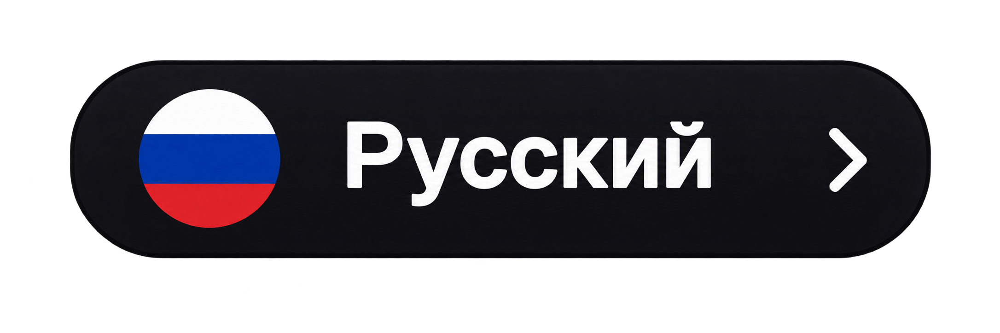
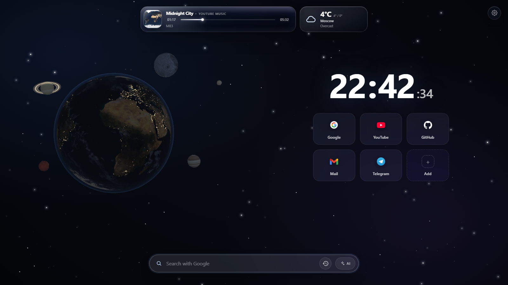
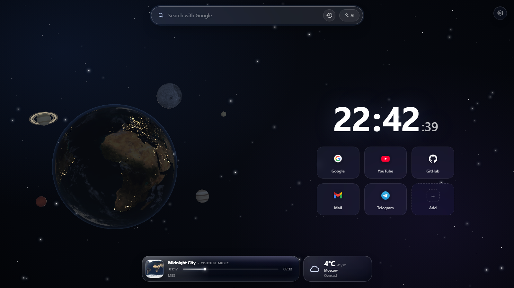
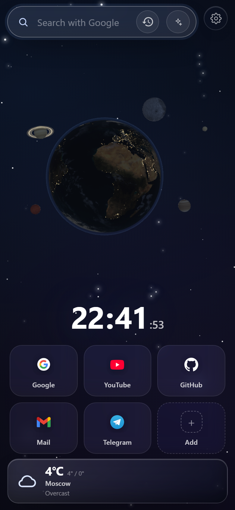
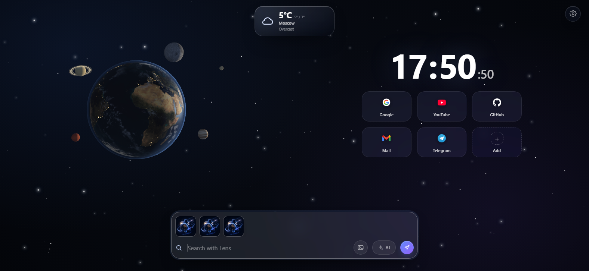
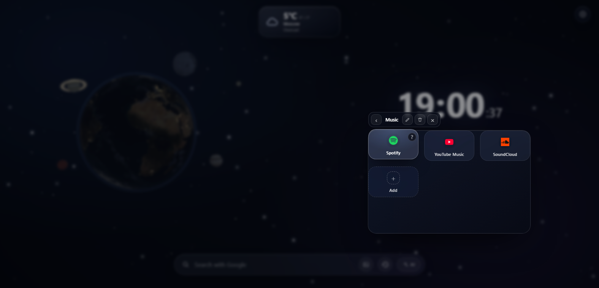
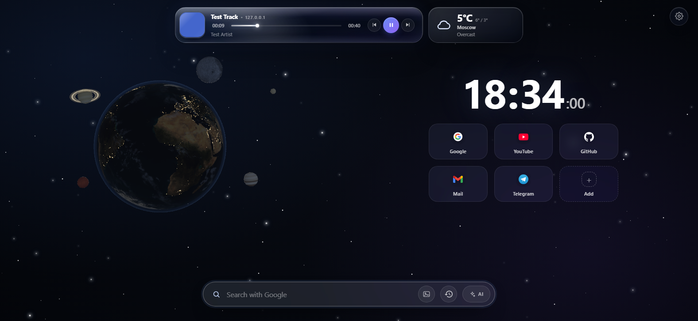
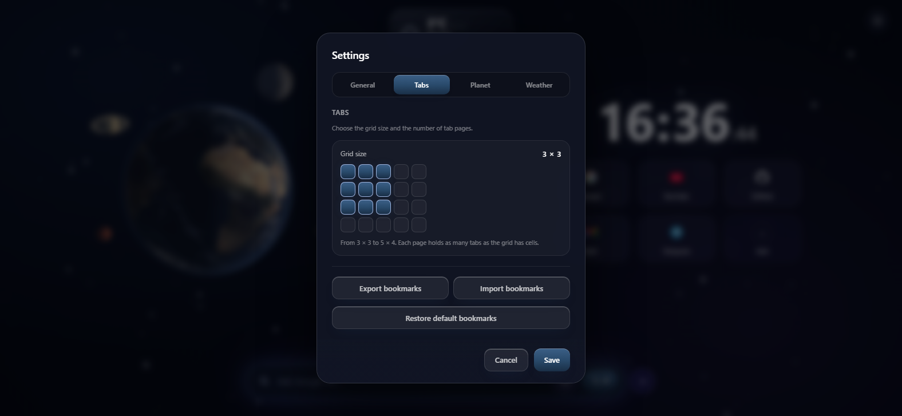

<p align="center">
  
</p>

<h1 align="center">CosmoTab</h1>

<p align="center">
  <strong>Окно во Вселенную в каждой новой вкладке.</strong><br>
  Живая 3D-Земля, погода, управление музыкой, закладки и поиск — в одном спокойном стеклянном интерфейсе.
</p>

<p align="center">
  <a href="README.md"></a>
  &nbsp;
  <a href="README_RU.md"></a>
</p>

<p align="center">
  
  
  
  
  
</p>

<p align="center">
  
</p>

---

## О проекте

**CosmoTab** превращает каждую новую вкладку в тихое окно в космос.

Вместо очередной пустой страницы или нагромождения виджетов — медленно вращающаяся Земля, несколько полезных инструментов и ничего лишнего. Всё работает локально, быстро и ощущается как маленькая частичка Вселенной.

## Возможности

- **Живая 3D-Солнечная система.** Земля с независимым слоем облаков, Луна, планета с кольцами и далёкие миры. Сцену можно вращать мышью с инерцией, а после отпускания Земля и Луна плавно возвращаются на свою орбиту. Иногда по небу проносится комета, а Луна проходит и за Землёй, и перед ней.
- **Сезонное освещение и ручные режимы.** Авто-режим учитывает сезон и местное время. С наступлением темноты тень двигается крошечными незаметными шагами каждую минуту. Плюс четыре варианта: авто, день, 50/50 и ночь.
- **Погода без лишнего шума.** Текущие условия и дневной диапазон для 30 городов, °C или °F. Основной источник — `wttr.in`, резервный — Open-Meteo, повтор запроса по клику.
- **Сейчас играет.** CosmoTab подхватывает звук из других вкладок и показывает обложку, название, исполнителя, источник и перематываемую шкалу в компактной стеклянной панели.
- **Поиск на ваш вкус.** Google, Яндекс, Bing или DuckDuckGo, а также ИИ-режим с выбором Google AI, ChatGPT, DeepSeek или Gemini.
- **Картинки и файлы двумя способами.** Добавьте картинку или другой файл кнопкой «+», вставьте изображение или перетащите его на строку поиска. Картинки уходят в Google AI или Объектив, остальные файлы открываются в новой вкладке.
- **Сетка вкладок под ваш экран.** Выберите любой размер от 3 × 3 до 5 × 4 визуальным редактором в настройках. Сетка расширяется вместе с числом столбцов, а не сжимает плитки; страницы переключаются стрелками и точками.
- **Перетаскивание для порядка.** Перетащите вкладку к краю другой, чтобы поставить её слева, справа, выше или ниже; отпустите в центре, чтобы создать папку.
- **Настройки по вкладкам.** Разделы «Общие», «Вкладки», «Планета» и «Погода» держат все параметры под рукой.
- **Плеер с настоящими кнопками.** Назад, пауза/играть и вперёд в liquid-glass панели. Пауза не скрывает плеер, поэтому воспроизведение можно продолжить с новой вкладки.
- **Два языка и гибкие настройки.** Русский и английский, два расположения, включение погоды, город и единицы температуры.
- **Приватность по умолчанию.** Без аккаунтов, телеметрии и удалённого кода. Настройки и закладки хранятся локально.
- **Фиксированная композиция.** Масштабирование страницы и жесты щипка отключены, а строка поиска раскрывается, не сдвигая планеты, чтобы интерфейс оставался таким, как задуман.

## Расположение

Поиск внизу или всё служебное наверху? Доступны оба варианта — выбор сохраняется сразу.

<p align="center">
  
  &nbsp;
  
</p>

На узких экранах плеер и погода встают под закладками, а не перекрывают их.

## Картинки для ИИ и Объектива

<p align="center">
  
</p>

Добавляйте файлы кнопкой «+» справа от строки поиска, вставляйте изображения через `Ctrl+V` или перетаскивайте их на строку поиска. Картинки показываются превью, остальные файлы — плашкой с расширением. Вложения не отправляются сразу: строка поиска раскрывается вверх, а поле ввода остаётся на месте. В строке поиска можно написать вопрос к изображению. Отправка — только по кнопке с самолётиком справа; `Enter` вложение не отправляет. Можно добавить до 10 файлов; несколько картинок перед отправкой объединяются в один коллаж. Если прикреплены только обычные файлы, кнопка отправки открывает их в новой вкладке. Картинки определяются по типу и расширению файла.

Для текстового поиска селектор ИИ в настройках отправляет запрос в Google AI, ChatGPT, DeepSeek или Gemini. Картинки всегда открываются через Google AI Mode или Google Lens.

## Папки закладок

<p align="center">
  
</p>

Выберите **Папка** в окне добавления. Папка открывается прозрачной сеткой 3×3 поверх сетки вкладок, а название показывается по центру над папкой. Нажмите на название, чтобы переименовать. Внутри есть своя кнопка добавления; закладки можно перетаскивать внутрь, а чтобы вынести — перетащите за пределы панели. Если перетащить одну закладку на другую, сразу создастся новая папка с ними двумя. Если отпустить её у края — она встанет слева, справа, выше или ниже. Клик мимо вкладок или `Esc` закрывает папку.

## Плеер

<p align="center">
  
</p>

В liquid-glass плеере есть кнопки «Назад», «Пауза / Играть» и «Вперёд». Пауза больше не скрывает панель: она остаётся на новой вкладке, и та же кнопка продолжает воспроизведение. Переключение треков использует кнопки самого сайта, а если их нет — медиа-клавиши.

## Настройки

<p align="center">
  
</p>

- **Язык интерфейса** — русский или английский. Английский используется, пока язык не изменён вручную.
- **Расположение** — поиск внизу (классический вид) или поиск вверху, а плеер и погода внизу.
- **Освещение Земли** — авто по сезону и времени, день, 50/50 или ночь.
- **Поисковик** — Google, Яндекс, Bing, DuckDuckGo и выбор ИИ: Google AI, ChatGPT, DeepSeek или Gemini.
- **Погода** — включение, выбор города, °C или °F.
- **Вкладки** — визуальный редактор сетки от 3 × 3 до 5 × 4, папки, экспорт в JSON, импорт из JSON, возврат стандартного набора.

Настройки собраны во вкладки **«Общие»**, **«Вкладки»**, **«Планета»** и **«Погода»**.

## Установка

| Браузер | Шаги |
| --- | --- |
| **Firefox** | Откройте `about:debugging` → **Этот Firefox** → **Загрузить временное дополнение** → выберите `manifest.json`. Чтобы CosmoTab открывался как домашняя страница, включите в Firefox открытие домашней страницы при запуске. |
| **Firefox для Android** | Установите подписанный XPI (из AMO или self-distributed), затем откройте CosmoTab из меню расширений. Заменить системную новую вкладку на Android нельзя. |
| **Chrome / Chromium** | Откройте `chrome://extensions` → включите **Режим разработчика** → **Загрузить распакованное расширение** → выберите папку `chrome`. |

Папка `chrome` уже собрана в репозитории. После изменения общих файлов пересоберите её:

```bash
node build-chrome.js
```

Подробности и решение проблем: [INSTALL.md](INSTALL.md).

## Firefox для Android

Firefox Android не позволяет расширениям заменять новую вкладку. CosmoTab всё равно устанавливается и работает: нажмите иконку CosmoTab в меню расширений, и страница откроется в обычной вкладке. При первой установке она открывается автоматически.

Минимальные версии: Firefox 140 и Firefox для Android 142 — ограничение Android связано с `data_collection_permissions` в манифесте. ZIP с GitHub предназначен для временной загрузки на десктопе; для Android нужен подписанный XPI.

## Технологии

- Manifest V3, чистые HTML, CSS и JavaScript — без фреймворка и сборки для основной страницы.
- Three.js лежит локально в `lib/three.min.js`, текстуры поставляются вместе с расширением — ничего не загружается с CDN.
- Небольшой адаптер WebExtension API позволяет одному коду работать с `browser.*` (Firefox) и `chrome.*` (Chromium).
- Погода берётся из `wttr.in`, при ошибке — из Open-Meteo.
- Фоновый скрипт отвечает за кнопку расширения на Android и переход из поиска по картинке в AI Mode.
- Минимальные версии: Firefox 140 на десктопе и 142 на Android (`data_collection_permissions`).
- Chromium-сборка создаётся скриптом `build-chrome.js`.

## Структура проекта

```text
.
├── index.html          # Страница новой вкладки
├── style.css           # Раскладка, стеклянный интерфейс, адаптивность
├── script.js           # Сцена, погода, плеер, закладки, настройки
├── background.js       # Кнопка расширения и переход в AI Mode
├── manifest.json       # Точка входа для Firefox и Manifest V3
├── build-chrome.js     # Сборка версии для Chromium
├── chrome/             # Готовая Chromium-версия
├── icons/              # Иконки закладок
├── textures/           # Текстуры Земли, Луны и истории
├── lib/three.min.js    # Локальный Three.js
├── README.md
├── README_RU.md
└── INSTALL.md
```

## Приватность

CosmoTab не собирает аналитику и персональные данные. Настройки и закладки хранятся локально в браузере. Единственные сетевые запросы — за погодой и на выбранную вами поисковую страницу. Картинки для ИИ или Объектива отправляются в Google только после подтверждения.

## Лицензия

Проект распространяется по [лицензии MIT](LICENSE).

---

<p align="center">
  <strong>CosmoTab — частичка Вселенной в каждой вкладке.</strong><br>
  Создано с любовью.
</p>
